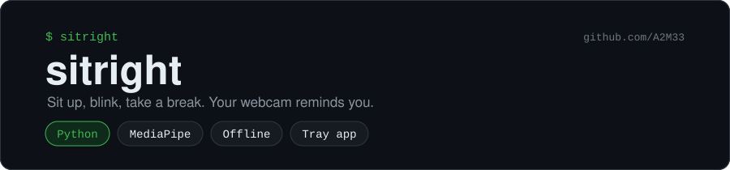
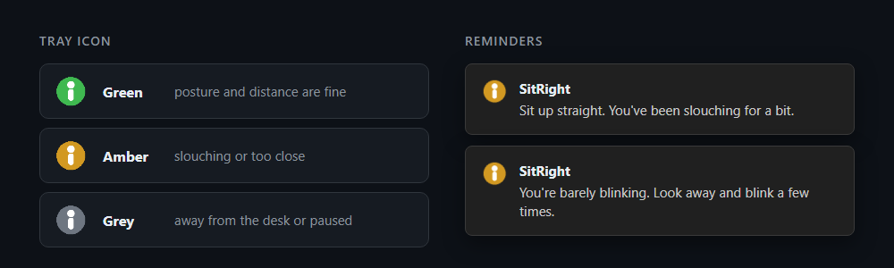

<p align="center"></p>

<p align="center">
  <a href="https://github.com/A2M33/sitright/actions/workflows/test.yml"></a>
  
  
  <a href="https://github.com/A2M33/sitright/blob/main/LICENSE"></a>
</p>

Hours at a desk and you slouch without noticing. SitRight sits in the system tray, watches your posture through the webcam, and sends a notification when you slouch, lean into the screen, stop blinking or forget to get up.



<!-- demo GIF goes here -->

It runs on your computer only. SitRight reads each frame in memory, measures it and drops it. It never saves or uploads an image.

## What it reminds you about

| Reminder | When |
| --- | --- |
| Sit up straight | your head stays lower than your calibrated pose for 30 seconds |
| Lean back | your face looks about 25% bigger than usual, so you've moved toward the screen |
| Blink | fewer than 8 blinks a minute (a relaxed person blinks 15 to 20 times, far fewer while staring at a screen) |
| Take a break | 50 minutes at the desk without leaving for at least 2 minutes |

You get the same reminder at most once every 5 minutes. The tray icon shows green when your posture is fine, amber while you slouch or sit too close, and grey when you've left the desk or paused it.

## Install

Needs Python 3.10 or newer and a webcam.

```bash
pip install git+https://github.com/A2M33/sitright
sitright
```

On first start it downloads MediaPipe's face model (about 4 MB). Then it asks you to sit the way you want to sit for a few seconds and saves that pose as your baseline. You can calibrate again from the tray menu.

On Linux you may need a tray extension for your desktop (for GNOME: AppIndicator) and `notify-send` for notifications.

### Start it with your computer

- Windows: press `Win + R`, type `shell:startup`, and put a shortcut to `sitright` in that folder.
- Linux: add `sitright` to your desktop's "Startup Applications".

## Preview mode

```bash
sitright --preview
```

This opens a camera window with live readings for posture, distance and blinks per minute. Press `C` to calibrate and `Q` to quit. I use it to check a new camera or a dark room before trusting the tray app.

Other options: `--camera 1` to pick a different camera, `--version`.

If the preview shows a logo instead of your face, camera 0 is a virtual camera from OBS or Snap Camera. Try `--camera 1`, `--camera 2` and so on until you see yourself, then start the tray app with that number.

## Tuning

Settings live in `%APPDATA%\sitright\config.json` on Windows and `~/.config/sitright/config.json` on Linux. Edit the numbers under `thresholds` and restart:

| Key | Default | Meaning |
| --- | --- | --- |
| `slouch_drop` | 0.07 | how far your head may drop, as a fraction of the camera image height |
| `too_close_ratio` | 1.25 | how much bigger your face may get before "lean back" |
| `hold_seconds` | 30 | how long bad posture must last before a reminder |
| `min_blinks_per_minute` | 8 | below this you get the blink reminder |
| `break_after_minutes` | 50 | time before the break reminder |
| `away_reset_seconds` | 120 | leaving this long counts as a break |
| `cooldown_seconds` | 300 | minimum gap between two identical reminders |

## How it works

[MediaPipe Face Landmarker](https://ai.google.dev/edge/mediapipe/solutions/vision/face_landmarker) finds 478 points on your face in each frame, about 12 times a second.

- **Posture.** SitRight compares the height of your nose tip and the width of your face with your calibrated values. A webcam can't see your back. Your head drops when you slouch, though, and a camera measures that well.
- **Blinks.** It uses the eye aspect ratio, eye height divided by eye width, which drops to near zero when you close your eyes. The cut-off sits at 70% of your own open-eye value, so glasses and eye shape don't throw it off.

The decision logic lives in `src/sitright/monitor.py` with no camera code, so the tests feed it fake measurements:

```bash
pip install -e ".[dev]"
pytest
```

## Privacy

- SitRight never writes an image to disk or sends one anywhere.
- Its only network request is the one-time model download from Google's storage.
- Pausing from the tray menu releases the camera, so its light goes off.

## License

MIT
