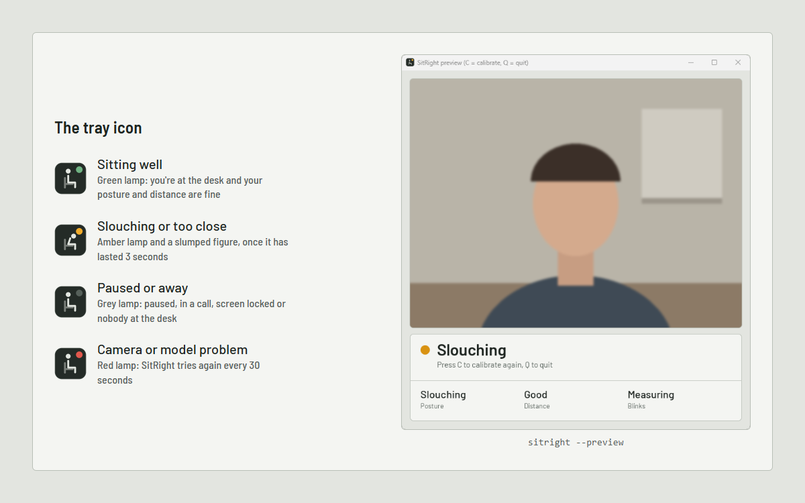

<p>
  <a href="https://github.com/A2M33/sitright/actions/workflows/test.yml"></a>
  
  
  <a href="https://github.com/A2M33/sitright/blob/main/LICENSE"></a>
</p>

Hours at a desk and you slouch without noticing. SitRight sits in the system tray, watches your posture through the webcam, and sends a notification when you slouch, lean into the screen or forget to get up.

<picture>
  <source media="(prefers-color-scheme: dark)" srcset="docs/overview-dark.png">
  
</picture>

A demo GIF is on its way. I'm recording it on a real webcam. Until then, the preview window above shows a drawn stand-in where your camera picture would be.

SitRight runs on your computer. It reads each frame in memory, measures it and drops it. It never saves or uploads an image.

## What it reminds you about

| Reminder | When |
| --- | --- |
| Sit up straight | your head stays lower than your calibrated pose for 30 seconds |
| Lean back | your face looks about 25% bigger than usual for 30 seconds, so you've moved toward the screen |
| Take a break | 50 minutes at the desk without leaving for at least 2 minutes |
| Blink (off by default) | fewer than 8 blinks a minute. I haven't checked the blink counter on enough cameras to switch it on for everyone. Turn it on under Reminders if you want to try it. |

Two reminders never arrive less than 2 minutes apart, and you see the same one at most once every 5 minutes. The lamp on the tray icon turns green when your posture is fine, amber once you've slouched or sat too close for 3 seconds (the figure slumps too), grey when you've left the desk or SitRight is paused, and red when the camera or the face model isn't working.

## Install

You need Python 3.10 or newer and a webcam. Git is optional: pip can install from the zip file GitHub serves.

```bash
pip install https://github.com/A2M33/sitright/archive/refs/heads/main.zip
sitright-tray
```

`sitright-tray` starts the app with no console window. `sitright` starts the same app from a terminal and takes the options under [Preview mode](#preview-mode). With Git installed, `pip install git+https://github.com/A2M33/sitright` works too.

On first start SitRight downloads MediaPipe's face model (about 4 MB) and opens a small calibration window. Sit the way you want to sit, look at the screen, and wait for the 3-2-1 countdown. SitRight then records your pose for 3 seconds and saves it as your baseline. If the download fails, SitRight tries again every 30 seconds.

On Linux you may need a tray extension for your desktop (for GNOME: AppIndicator) and `notify-send` for notifications.

## The tray menu

Right-click the icon.

| Item | What it does |
| --- | --- |
| Today: 82% upright, 3 breaks | your numbers for today (see [Daily stats](#daily-stats)) |
| Resume | shows up while SitRight is paused |
| Pause | 30 minutes, 1 hour, or until tomorrow at 06:00. SitRight lets go of the camera, so its light goes off. |
| Pause > Pause during calls | on by default, see below |
| Snooze 15 min | keeps watching but holds back reminders for 15 minutes |
| Reminders | switch each reminder on or off |
| Sensitivity | Relaxed, Normal or Strict. Relaxed lets your head drop 40% further and waits 40% longer before a reminder; Strict tightens both by 30%. |
| Calibrate | opens the calibration window again. It warns you if your face looks too close, too far or off to the side of the picture. Close the window or press Esc to keep your old pose. |
| Camera | lists the cameras that deliver a picture. Picking another one saves it and starts a new calibration. |
| Start with Windows | adds SitRight to your user's Run key in the registry |

Settings changed in the menu apply at once and go straight into `config.json`. A pause or a snooze ends when you quit SitRight.

### Pausing during calls

When Zoom, Teams, a browser tab or any other app holds your camera or microphone, SitRight pauses itself and the tooltip names the app. It picks up again on its own once the call ends. Windows records which apps use the camera and mic under `HKEY_CURRENT_USER\Software\Microsoft\Windows\CurrentVersion\CapabilityAccessManager\ConsentStore`, and SitRight reads that every 5 seconds.

Noise filters such as NVIDIA Broadcast, Krisp and Voicemeeter hold the microphone for as long as they run, so SitRight ignores them. If some other app keeps it paused all day, untick "Pause during calls".

### When the camera fails

If the camera disappears or another program grabs it, the tooltip reads "camera busy or not found" and SitRight tries again every 30 seconds. A short outage doesn't count as you leaving the desk. After 2 minutes without a picture SitRight can't tell where you went, so it starts the sitting timer over when the camera comes back.

### Locked screens and sleep

Lock your screen and SitRight lets go of the camera until you unlock it. Time behind the lock screen counts as time away, so 2 minutes or more counts as a break. After sleep SitRight reopens the camera and starts the sitting timer over.

### Start it with your computer

- Windows: tick "Start with Windows" in the tray menu.
- Linux: add `sitright-tray` to your desktop's "Startup Applications".

## Preview mode

```bash
sitright --preview
```

This opens a camera window with live readings for posture, distance and blinks per minute. Press `C` to calibrate and `Q` to quit. I use it to check a new camera or a dark room before trusting the tray app.

Other options: `--camera 1` uses camera 1 for this run without saving it, and `--version` prints the version.

If the preview shows a logo instead of your face, camera 0 is a virtual camera from OBS or Snap Camera. Pick another one from the tray's Camera menu, or try `--camera 1`, `--camera 2` and so on.

## Tuning

Settings live in `%APPDATA%\sitright\config.json` on Windows and `~/.config/sitright/config.json` on Linux. The tray menu writes `reminders`, `sensitivity`, `camera` and `auto_pause` for you. Edit the numbers under `thresholds` and restart:

| Key | Default | Meaning |
| --- | --- | --- |
| `slouch_drop` | 0.07 | how far your head may drop, as a fraction of the camera image height |
| `too_close_ratio` | 1.25 | how much bigger your face may get before "lean back" |
| `hold_seconds` | 30 | how long bad posture must last before a reminder |
| `look_down_degrees` | 15 | tip your head further than this from your calibrated angle and SitRight treats it as reading notes, not slouching |
| `min_blinks_per_minute` | 8 | below this you get the blink reminder |
| `break_after_minutes` | 50 | time before the break reminder |
| `away_reset_seconds` | 120 | leaving this long counts as a break |
| `cooldown_seconds` | 300 | minimum gap between two identical reminders |
| `reminder_gap_seconds` | 120 | minimum gap between any two reminders |
| `face_lost_grace_seconds` | 1.5 | the face may vanish this long (a hand on your chin, a quick turn) without resetting anything |

The Sensitivity menu scales the first three on top of what you write here and leaves your numbers in the file alone. So does calibration.

A typo won't stop SitRight from starting. It skips keys it doesn't know, uses the default for a value of the wrong type or one that can't work (a negative time, a blink window of 0), and shows a notification listing what it ignored. If it can't parse the file at all, it starts on defaults and copies your file to `config.json.bad` before its next save.

## Daily stats

SitRight keeps one small file per day in the `stats` folder next to `config.json`, for example `stats/2026-03-02.json`. Each file holds the time it saw you at the desk, how much of that time your posture and distance were fine, the breaks you took (2 minutes or more away) and how many reminders of each kind you got. The files hold numbers and nothing else.

## How it works

[MediaPipe Face Landmarker](https://ai.google.dev/edge/mediapipe/solutions/vision/face_landmarker) finds 478 points on your face in each frame, 20 times a second, at 640x480. While the desk is empty it looks 5 times a second, because searching an empty picture for a face costs the most CPU.

- **Posture.** SitRight compares the height of your nose tip and the width of your face with your calibrated values. A webcam can't see your back. Your head drops when you slouch, though, and a camera measures that well. MediaPipe also reports the angle of your head. If you tip it down to read notes, your nose drops as well, so SitRight ignores the drop while your head angle sits more than 15 degrees off your calibrated one. Poses calibrated before version 0.2.0 have no angle; calibrate again to get this.
- **Blinks.** It uses the eye aspect ratio, eye height divided by eye width, which drops to near zero when you close your eyes. The cut-off sits at 70% of your own open-eye value, so glasses and eye shape don't throw it off. A blink lasts 100 to 150 ms, and at 20 frames a second SitRight sees at least two frames of each one.

The decision logic lives in `src/sitright/monitor.py` and `src/sitright/engine.py` with no camera code, so the tests feed them fake measurements and a fake camera:

```bash
pip install -e ".[dev]"
pytest
```

The images in this README come from the same code: `python tools/docs/render.py` draws the icons with the tray's own drawing code and screenshots the real preview window on Windows, with a drawn picture in place of the camera.

## Privacy

- SitRight never writes an image to disk or sends one anywhere.
- Its only network request is the one-time model download from Google's storage.
- Pausing from the tray menu or locking your screen releases the camera, so its light goes off.

## License

MIT
